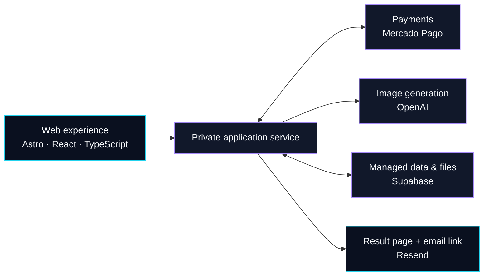

SGODX / PRODUCT CASE STUDY

# SGX VI — AI Image Creation

**A commercial web experience connecting personal images, AI generation and digital delivery.**

Built by **David Castro** · **SGODX**

[Product](#product-features) · [Architecture](#high-level-architecture) · [Engineering](#engineering-highlights) · [Project overview](docs/PROJECT_OVERVIEW.md)

**[Architecture Explorer — interactive public diagrams](docs/index.html)**

[Equivalent text reading](docs/architecture-explorer/reading.html)

Ready for local review · GitHub Pages publication awaits approval

Public product showcase · Private commercial source code

## Overview

**SGX VI** is a production application for creating personalized, GTA VI-inspired digital artwork. Its public journey connects one or two image uploads and an email address to a Mercado Pago checkout, then describes generation after confirmed payment and delivery through a result page and email link.

This case study presents the product experience and documented technology choices. The commercial implementation and proprietary workflows are maintained privately.

**Explore the application:** [create.sgodx.com](https://create.sgodx.com/) · **Author:** [David Castro / dpsychoo](https://github.com/dpsychoo)

## Application screenshots

Real production interface captures, reviewed on **13 October 2026**. Inputs are empty, no images are uploaded, and consent is unchecked. The captures are cropped to the original creation controls; the mobile view uses browser emulation.

### Desktop creation interface

  

<strong>Mobile creation interface · 390px viewport</strong>

  

<strong>Image-upload interface · empty state</strong>

  

Capture sizes and provenance are recorded in the [screenshot inventory](assets/screenshots/README.md). No checkout or purchase was performed.

## Product features

| Capability | Public product experience |
| :-- | :-- |
| **Immersive presentation** | A themed landing experience with scroll-driven transitions and responsive creation controls. |
| **Personalized input** | One or two images, an email field and an empty-state upload indicator. |
| **Purchase clarity** | A pre-payment summary of the service, inputs, delivery, price and payment provider. |
| **Explicit consent** | Terms, privacy and refund-policy links accompany the consent control before checkout. |
| **Hosted payment flow** | A Mercado Pago payment CTA; the published service starts processing after payment confirmation. |
| **Digital delivery** | The published flow provides a generated result page and an email link. |

Screenshots and walkthrough cover the public pre-payment interface. Generation and delivery are described from the application's published service information.

## Technology stack

| Responsibility | Technology |
| :-- | :-- |
| Frontend | Astro, React, TypeScript |
| Managed data and file storage | Supabase |
| AI image processing | OpenAI |
| Payments | Mercado Pago |
| Transactional email | Resend |
| Hosting and application execution | Vercel |

The frontend stack is recorded in the existing [project overview](docs/PROJECT_OVERVIEW.md). Provider responsibilities are identified in the application's [published privacy policy](https://create.sgodx.com/privacidad). These are documented technology choices; this showcase is not a source-code audit.

## High-level architecture

The explorer is a high-level product view based on public documentation; it does not disclose the private implementation or source code.

Explore the four [interactive Archify views](docs/index.html): product responsibilities, the customer journey, payment and delivery, and SGX PASS. Each view supports zoom, node search and guided navigation. The [publication proposal](docs/architecture-explorer/PUBLISHING.md) documents the future GitHub Pages setup; publication is not enabled by these changes.

The following responsibility map summarizes the public product journey and published provider roles. Payment confirmation precedes image generation; Vercel provides hosting and application execution.

This diagram describes responsibilities at the product level. It does not specify internal endpoints, database models, deployment topology or proprietary generation logic.

## Engineering highlights

- **Experience design:** Connects an immersive landing presentation to focused, responsive input controls.
- **Commerce-aware UX:** Places the service summary, consent and policy links before the payment CTA.
- **Delivery journey:** Coordinates the documented input → confirmed payment → generation → result-and-email flow.
- **Provider composition:** Brings together managed services for storage, AI generation, payments, email and deployment.
- **Public/private separation:** Makes the product and engineering context reviewable while keeping commercial source code private.

Further product context remains available in the [project overview](docs/PROJECT_OVERVIEW.md).

## Security and privacy considerations

Image uploads and email addresses require careful handling. The [privacy policy](https://create.sgodx.com/privacidad) describes data use, image retention, provider involvement and user rights. It states that payment instrument data is handled by the payment provider and describes file validation and protected result access.

The public interface presents consent and links to the [terms](https://create.sgodx.com/terminos), [privacy policy](https://create.sgodx.com/privacidad) and [refund policy](https://create.sgodx.com/reembolsos) before payment. These are published product and policy statements, not independently audited security or compliance claims.

This repository contains documentation and reviewed empty-state screenshots. It includes no customer uploads, personal contact data, payment records, credentials, database schemas, internal API details or production source code. See [NOTICE.md](NOTICE.md) for repository scope and reuse conditions.

## Independent project disclaimer

SGX VI is an independent creative experience by SGODX and is not affiliated with, sponsored by, or endorsed by Rockstar Games or Take-Two Interactive. GTA VI and related trademarks belong to their respective owners. No license to third-party artwork, logos, or game assets is granted by this repository.
